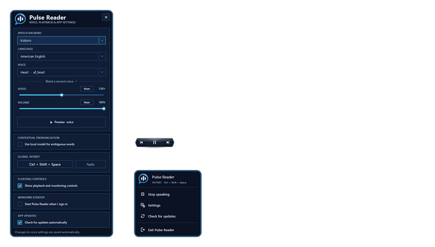

#  Pulse Reader

[](https://github.com/sponsors/Mark-A-Richardson)

Pulse Reader is a Windows tray utility that reads selected text aloud. Select text in an application, then press `Ctrl + Shift + Space` to start speaking. Press the same hotkey again to stop, or hold it briefly to monitor new text appearing in the current window.

Kokoro runs locally with `af_heart` as the default voice. After the first model download, speech works offline and selected text does not leave the computer. If Kokoro cannot start or synthesize a selection, Pulse Reader falls back to an installed Windows voice.

## What it does

- Reads normally selectable text through a global hotkey
- Includes all 54 standard Kokoro v1.0 voices and optional two-voice blending
- Can use an optional local model to correct approved context-dependent pronunciations
- Provides Windows voice selection, speed, volume, and preview controls
- Keeps the tray application responsive while speech loads and plays
- Shows floating controls for pause, resume, reading-unit navigation, and stop
- Can monitor one window and read newly appearing accessibility text as it arrives
- Supports start-with-Windows registration for the current user
- Checks quietly for stable releases, with an opt-out and a manual tray-menu update action

## Interface

<a href="docs/assets/interface-overview.png"></a>

## Requirements

- Windows x64. Windows 11 is recommended; the installer accepts Windows 10 build 19041+, but Windows 10 has not been release-tested.
- An internet connection for the first Kokoro model download, unless the model is installed manually
- An installed Windows speech voice for fallback speech
- [.NET 10 SDK](https://dotnet.microsoft.com/download/dotnet/10.0) when building from source

Use a Windows edition/version covered by the [.NET 10 support policy](https://github.com/dotnet/core/blob/main/release-notes/10.0/supported-os.md). Installer compatibility is not a promise of Microsoft support for older Windows versions.

## Install and run

When a release is available, download the standard Windows x64 installer from [Releases](https://github.com/qdg-main/pulse-reader/releases). It includes the .NET runtime and native speech dependencies, but no models. Installation defaults to your Windows account without administrator access. You can instead install for all users with administrator approval; model downloads are then shared between accounts, while settings stay individual.

The portable ZIP contains the same application files. Extract the whole folder before running `PulseReader.exe`. The smaller `framework-dependent` packages need the [.NET 10 Windows Desktop Runtime for x64](https://dotnet.microsoft.com/en-us/download/dotnet/10.0) installed separately. No SDK is needed to use a release.

The installer presents the bundled Microsoft runtime terms separately from
Pulse Reader's MIT licence. Portable copies ask once on first launch unless
you already accepted the same terms through the installer.

On first launch, setup downloads Kokoro with progress, cancellation, and retry. Choose **Windows voice** to use an installed voice without downloading Kokoro. Enabling **Use local model for ambiguous words** in Settings downloads the optional classifier and its runtime, about 2.5 GB. It stays off unless you enable it.

Uninstall preserves models and settings by default. You can also remove downloaded dependencies, or remove all Pulse Reader files. A full all-users cleanup explicitly warns that it deletes other users' Pulse Reader settings. Logged-out users retain their Windows startup and terms-acceptance records. See [installation scope and cleanup](docs/configuration.md#installation-scope-and-cleanup) for storage and permissions.

Pulse Reader starts in the Windows notification area. Double-click the tray icon, or right-click it and choose **Settings**.

Packaged copies check for stable GitHub updates once a day while running. Turn
off **Check for updates automatically** in Settings to opt out. Use **Check for
updates** or **Update to <version>** in the tray menu to check or apply an update.
Updates keep the package flavour, installation scope, models and settings.
See [updating and interrupted-update recovery](docs/updating.md). The updater
has Candidate 29 self-contained helper/per-user installer and retained-recovery
evidence. Machine UAC, live framework-dependent updates, real update UI/HTTP
delivery and physical power-loss checks remain open.

### Build from source

From the repository root:

```powershell
dotnet build PulseReader.slnx --configuration Release
dotnet run --project src/PulseReader/PulseReader.csproj --configuration Release
```

Pulse Reader starts in the Windows notification area. Double-click the tray icon to open Settings, or right-click it to stop speech, open Settings, or exit.

## Use Pulse Reader

1. Select copyable text in an application.
2. Press `Ctrl + Shift + Space`.
3. Use the floating controls to restart the current reading unit, pause or resume, or move to the next unit. Hold the back button to restart the whole selection. Windows speech does not support reading-unit navigation, so its back and next buttons remain disabled.

   

4. Drag the control bar to keep it elsewhere for the current playback session. Hover over it to reveal the pin and stop controls. A position pinned inside the source window follows that relative window position on future reads; one pinned outside it stays monitor-relative. The bar does not move with a window during playback. Unpinning keeps the current position until playback ends and restores automatic placement next time.
5. Press `Ctrl + Shift + Space` again at any point to stop immediately.

To follow a live text feed, hold `Ctrl + Shift + Space` for about two-thirds of a second while its window is active. The control bar appears when the hold is recognised; you do not need to release the keys to attach. If text is selected, Pulse Reader copies and reads that first after release; otherwise, existing text becomes the baseline and only later additions are spoken. The controls fade away while the monitored window is idle and reappear when speech begins or the pointer approaches their position. Pause buffers new text, and the stop control or the tray's **Stop monitoring** command detaches.

While monitoring, a normal hotkey press in another window reads that selection after the current monitored sentence. The control bar moves to the manual selection's window, then returns to the monitored window afterward. Press the hotkey once to stop manual playback, or use its close button; neither detaches monitoring. Press again to read a new selection. Holding the hotkey on the monitored window again detaches; holding it on another window transfers monitoring there.

See [window monitoring details](docs/configuration.md#window-monitoring) for Codex, LM Studio, T3 Code, and Discord behaviour.

Open Settings to choose the speech backend, voice, optional voice blend, contextual pronunciation, speed, volume, hotkey, playback controls, and start-with-Windows behaviour. Selecting a voice plays a short preview.

## First Kokoro request

Pulse Reader downloads the full-precision Kokoro v1.0 model during initial setup. The model is about 320 MB. Downloads are checksum-verified before use, and later requests use the local copy.

The application uses the CPU-only Kokoro runtime and does not reserve GPU memory. See [configuration and model setup](docs/configuration.md) to install the model manually or inspect advanced settings.

## Current limitations

Pulse Reader first uses the normal Windows copy path. If that produces no text or the clipboard is temporarily unavailable, it makes one bounded Windows UI Automation attempt against the original active window. This recovers selections from compatible custom controls without changing the clipboard. Applications that expose neither a copyable selection nor the UI Automation `TextPattern`, or that run at a higher integrity level, may still not provide a selection. Pulse Reader does not use OCR.

Window monitoring also depends on the source exposing visible text through Windows UI Automation. Pulse Reader reads completed sentences and short settled fragments rather than every arriving token, and filters editable text, repeated submissions, and rapidly changing status labels. It ignores the initial accessibility snapshot, stays attached when another window is active, and stops automatically if the source window closes. Some canvases, terminals, elevated applications, and virtualized or inaccessible content may not expose a usable stream.

Pulse Reader restores regular clipboard formats after capturing a selection. If another application changes the clipboard before restoration, Pulse Reader leaves the newer contents in place instead of overwriting them. It warns when an application-specific format could not be cloned or restored. Pulse Reader does not manage Windows Clipboard History, and some delayed formats may not survive the temporary copy operation.

## More documentation

- [Configuration and model setup](docs/configuration.md)
- [Troubleshooting](docs/troubleshooting.md)
- [Updating and recovery](docs/updating.md)
- [Build, test, and publish](docs/development.md)
- [Project roadmap](docs/roadmap.md)
- [Pronunciation review notes](docs/pronunciation-notes.md)
- [Third-party notices](THIRD-PARTY-NOTICES.md)
- [Release preparation and validation](docs/releasing.md)

## Support development

If Pulse Reader is useful to you and you'd like to support its development, you can [sponsor me on GitHub](https://github.com/sponsors/Mark-A-Richardson). Donations are optional; all features remain available without donating.

Pulse Reader's own source code is [MIT licensed](LICENSE). Bundled dependencies and downloaded models have their own licences and notices.
